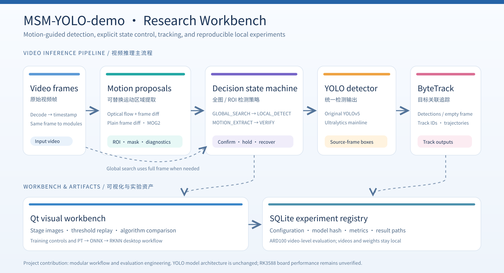
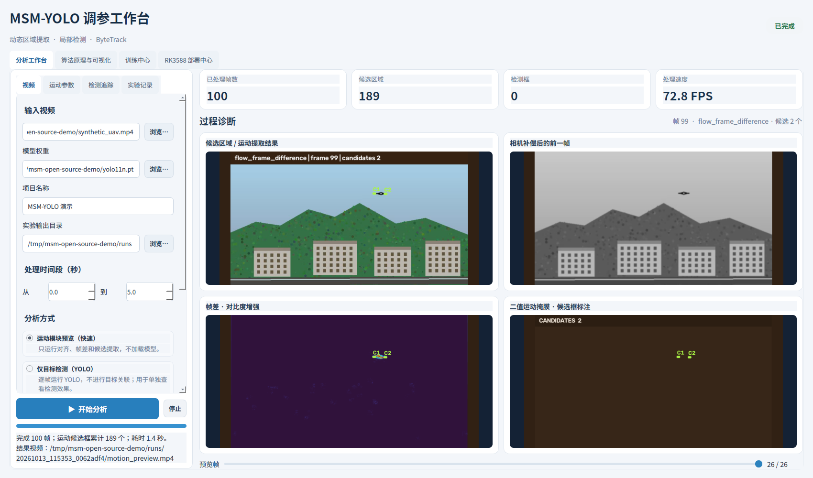
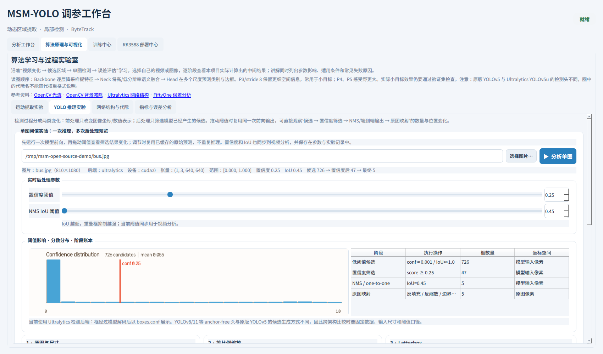

# MSM-YOLO-demo：无人机视频小目标检测实验工作台

[English README](README.md) · [功能截图与特写](docs/screenshots/README.md) · [运行环境](docs/setup.md) · [架构与贡献](docs/architecture.md) · [ARD100 汇总评测](docs/benchmark.md) · [参与贡献](CONTRIBUTING.md)

项目把**运动区域提取 → 全图/局部 YOLO 检测 → ByteTrack 跟踪 → 实验记录**串成可观察、可替换的本地 Qt 工作台。我们研究的是现有检测器周围的运动引导流程、状态控制和实验工程；**没有修改 YOLO 网络结构，也不宣称训练了新架构**。



## 页面预览

以下是实际运行的 Qt 界面截图。点击图片可看原尺寸；[功能截图与特写](docs/screenshots/README.md)逐项标出我们实现的部分。

| 运动引导分析 | YOLO 阈值实验 |
|---|---|
| [](docs/screenshots/01-motion-workbench.png) | [](docs/screenshots/03-yolo-thresholds.png) |
| 我们把相机补偿帧、帧差响应、掩膜和候选区域放在同一页，便于定位候选生成问题。 | 一次前向推理后缓存输出；拖动置信度和 NMS IoU 即可对照各阶段数量与图像。 |

运动截图使用合成场景；YOLO 与追踪截图使用 Ultralytics 示例 `bus.jpg`。这些截图展示界面与流程，不作为 UAV 检测精度或 RK3588 板端性能证据。

## 项目贡献

| 方向 | 已实现内容 |
|---|---|
| 运动候选 | 光流/相机运动补偿帧差、纯帧差、MOG2 三种可选后端，统一返回候选框、掩膜、差分图和中间过程；支持同视频算法对比。 |
| 状态机 | 全图搜索、局部检测、运动提取、运动验证四个状态；候选需由 YOLO 确认才锁定 ROI，失检后重新搜索。 |
| 检测与跟踪 | 原版 YOLOv5 与 Ultralytics 检测适配器；统一的原图坐标检测结果和追踪结果；ByteTrack 独立接口。默认 ROI 为 640×640。 |
| 可视化工作台 | Qt 分步预览、单图阈值实验、网络结构与指标讲解、训练任务入口、PC 端 PT → ONNX → RKNN 转换配置。 |
| 实验复现 | SQLite 保存参数、输入与模型路径/哈希、后端、设备、指标和产物路径；ARD100 视频级评测脚本及脱敏汇总表。 |

## 快速运行

建议 Python 3.10。CPU 可运行基础流程；使用 CUDA 时需自行安装与显卡兼容的 PyTorch 版本。仓库**不附带**模型、视频或数据集，首次启动可在页面内选择本机文件。

```bash
git clone https://github.com/zshi20000922-a11y/MSM-YOLO-demo.git
cd MSM-YOLO-demo
python -m venv .venv
source .venv/bin/activate
python -m pip install -r requirements.txt
python msm_tuner_gui.py
```

使用原版 YOLOv5 仓库训练的权重时，需另行取得兼容的 YOLOv5 代码并配置 `MSM_YOLOV5_ROOT`；Ultralytics 主线兼容的目标检测权重可选择 Ultralytics 后端。不要把两种 checkpoint 加载路径混用。详细说明见[环境文档](docs/setup.md)。

```bash
export MSM_VIDEO=/path/to/input.mp4
export MSM_WEIGHTS=/path/to/model.pt
export MSM_YOLOV5_ROOT=/path/to/yolov5
export MSM_ARD100_YAML=/path/to/ARD100.yaml
python msm_tuner_gui.py
```

运行现有检查：`python -m unittest discover -s tests -v`。如要复现实验，请自行准备有使用权的 ARD100 数据集和检测权重，再运行 `evaluate_ard100_motion.py --help` 查看显式参数。

## 代码地图

- [`msm_yolo_demo.py`](msm_yolo_demo.py)：运动候选、视频状态机、原版 YOLOv5 推理与 ByteTrack 桥接。
- [`msm_lab/`](msm_lab)：统一接口、运动/检测/追踪后端、评测、训练、部署及 SQLite 实验库。
- [`msm_tuner_gui.py`](msm_tuner_gui.py)：Qt 工作台。
- [`evaluate_ard100_motion.py`](evaluate_ard100_motion.py)：ARD100 视频级评测入口。
- [`tests/`](tests)：算法与流程检查。

## 边界

[已发布的评测表](docs/benchmark.md)比较的是**运动调度与 ROI 检测的组合流程**；由于 ROI 尺度同时变化，不能据此证明运动模块的独立精度收益。PC 端 RKNN 转换不等于 RK3588 板端精度或速度验证。原始数据、逐帧结果、权重、视频、量化校准集和运行数据库均未公开。

项目代码与文档采用 [AGPL-3.0](LICENSE)。Ultralytics、原版 YOLOv5、RKNN-Toolkit2、数据集和模型权重各有独立许可，详见[第三方说明](docs/third_party.md)。欢迎通过 Issue 和 Pull Request 参与。
