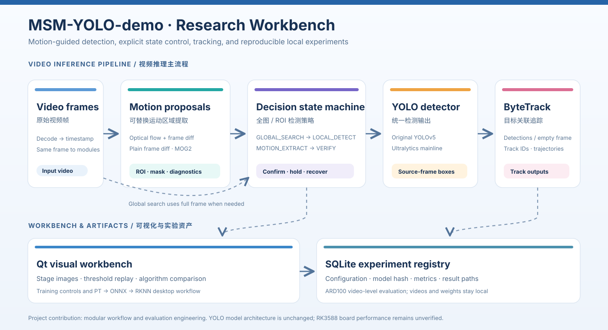

# Architecture and contribution map / 架构与贡献

## Video path / 视频主流程

1. Decode one frame. The selected `MotionAlgorithm` returns a `MotionResult` with proposals, binary mask, difference image, per-stage images, and diagnostics.
2. `MSMVideoPipeline` runs an explicit state machine: `GLOBAL_SEARCH` → `LOCAL_DETECT` on full-frame detection; otherwise `MOTION_EXTRACT` → `MOTION_VERIFY` for candidate ROI verification. A confirmed detection can maintain a local ROI. Misses and periodic checks return to broader search.
3. A detector backend maps every result to a source-frame `Detection` (box, class, confidence). The original YOLOv5 and Ultralytics adapters implement the same interface. Video modes can run motion-only, detection-only, motion + detection, or motion + detection + tracking.
4. `TrackerBackend` receives per-frame detections, including empty lists, and returns `Track` objects. The current implementation wraps ByteTrack.
5. Qt renders the annotated frame and diagnostic stage images. The SQLite experiment store records paths/hashes, configuration, backend versions, metrics, and artifact locations.

视频主流程：运动后端给出候选和诊断图；状态机决定全图、局部或运动候选验证；检测器统一输出原图坐标；ByteTrack 接收检测结果；Qt 展示过程，SQLite 登记实验。各模块契约见 [`msm_lab/interfaces.py`](../msm_lab/interfaces.py) 与 [`msm_lab/contracts.py`](../msm_lab/contracts.py)。

## Independent workflows / 独立工作流

- **Training:** Qt training center starts Ultralytics detection training in a background process, records progress and artifacts, and accepts a local YOLO dataset YAML. A legacy training adapter remains in the codebase for compatibility, but the current UI uses the Ultralytics adapter.
- **Deployment:** separate export and conversion subprocesses produce ONNX and RKNN files from a supported `.pt` model. FP16 and INT8 PTQ options are available in the UI; the converter relies on an external RKNN-Toolkit2 environment.
- **Evaluation:** `evaluate_ard100_motion.py` compares full-frame YOLO and selected motion-guided ROI pipelines using local video-level data. Published numbers are in [benchmark.md](benchmark.md).

## What is original here / 本项目贡献边界

The contribution is the **experiment platform and motion-guided control flow**: interchangeable proposals, explicit transitions, uniform model/tracker contracts, stage visualization, records, and benchmarking. It does not alter detector network layers, provide a faithful end-to-end reproduction of a paper's trained model, or establish RK3588 board performance. Those questions need separate code and measurements.

贡献在于**运动引导状态控制与实验平台工程**，不是 YOLO 主干网络创新。论文训练模型完整复现和 RK3588 板端性能均需另行验证。
