# 功能截图与特写 / Feature gallery

[返回中文首页](../../README_zh.md) · [English home](../../README.md)

这些图片来自实际运行的 Qt 工作台。运动演示输入是临时生成的山脉、建筑和移动小目标视频；YOLO 单图使用 Ultralytics 附带的 `bus.jpg` 示例图片；检测追踪视频由该图片模拟平移产生。临时视频、图片和模型权重没有进入仓库。截图用于说明**页面功能与数据流**，不是 ARD100 评测、真实 UAV 识别证明或 RK3588 板端性能结果。

These are captures from the running Qt workbench. Motion uses a temporary synthetic scene. The YOLO image is Ultralytics' bundled `bus.jpg`; the tracking clip simulates panning over that image. No source video, weight, or dataset was committed. The screenshots demonstrate the UI and data flow, not UAV accuracy or on-device performance.

## ① 运动候选分析 / Motion-guided analysis

**我们的实现：**同一帧并列查看运动候选、相机补偿后的上一帧、增强帧差和二值掩膜；顶部统计帧数与候选数。图中的绿色 C1/C2 是候选点，不代表 YOLO 已确认目标。

**Our work:** synchronized candidate, compensated-frame, difference-response, and mask views. C1/C2 are motion proposals, not confirmed detections.

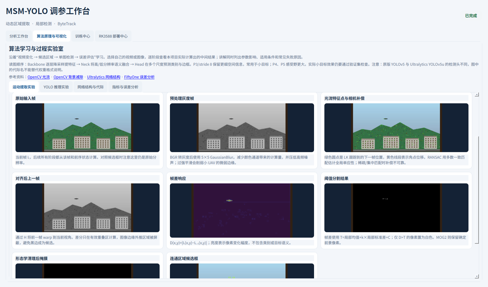

运动实验页把预处理、光流特征、相机补偿、帧差、阈值分割、形态学和连通域筛选逐步展开。页面支持光流加帧差、纯帧差和 MOG2 独立切换；每种算法维护自己的状态。

| ② 光流与相机补偿 | ③ 帧差响应 | ④ 连通域候选 |
|---|---|---|
| 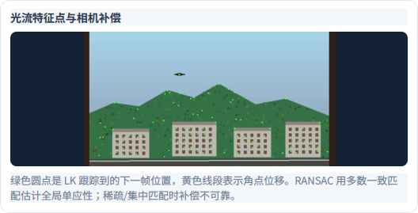 | 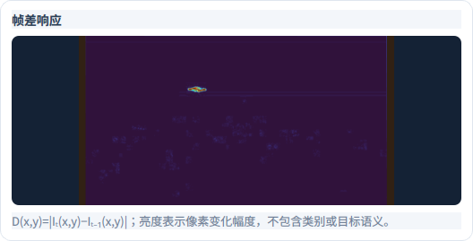 | 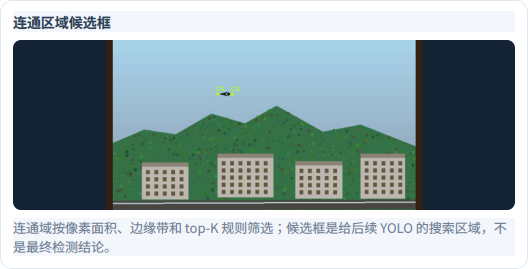 |
| LK 特征点与全局背景运动估计，供后续对齐。 | 对齐后前后帧的像素变化，仍不包含类别信息。 | 面积、边缘与 top-K 规则筛出的候选，交给 YOLO 核验。 |

## ⑤ YOLO 阈值与逐阶段结果 / Detection trace

**我们的实现：**一次推理后缓存候选，置信度和 NMS IoU 滑块即时重算后处理；分数直方图和阶段账本展示框数变化。图中 YOLO11n 检测器及其权重属于 Ultralytics；此项目没有修改检测网络。截图中的 `0.25` 是演示时选用的阈值，不是项目默认置信度 `0.60`。

**Our work:** cached postprocessing, interactive thresholds, confidence histogram, and per-stage counts. The YOLO11n detector itself is upstream software. The screenshot's `0.25` confidence is a demo setting; the project default is `0.60`.

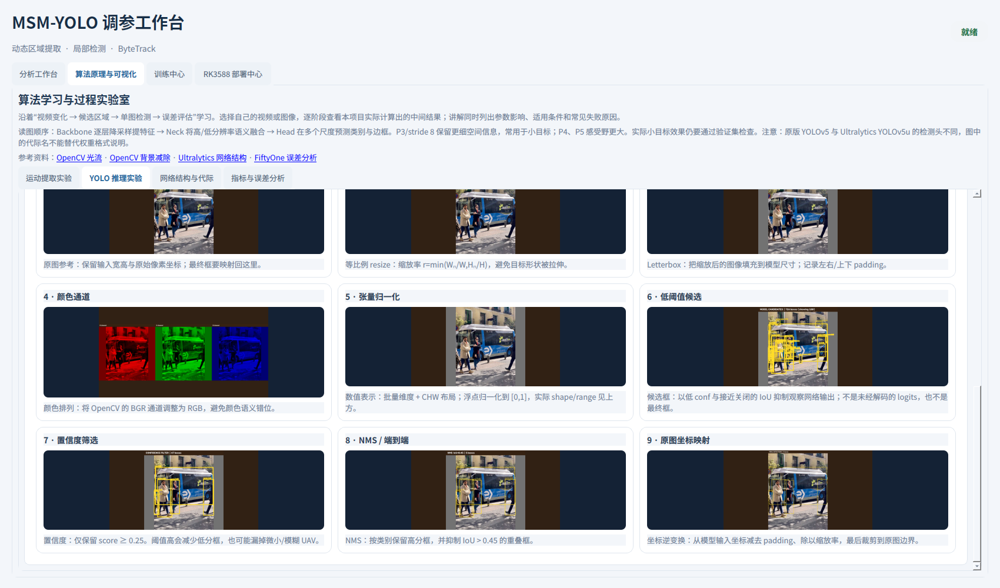

从原图、等比例缩放、Letterbox、颜色与张量变换，到候选、置信度筛选、NMS 和原图坐标映射，页面逐阶段给出图像和解释。黄色框反映当前公开示例图上的模型输出，不是 UAV 结果。

| ⑥ 低阈值候选 | ⑦ 置信度筛选 |
|---|---|
| 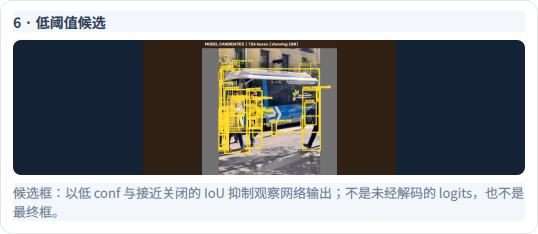 | 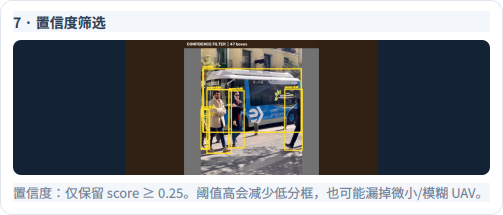 |
| 便于观察检测器解码后的候选。 | 只保留达到当前分数阈值的框。 |

| ⑧ NMS 后 | ⑨ 原图坐标 |
|---|---|
| 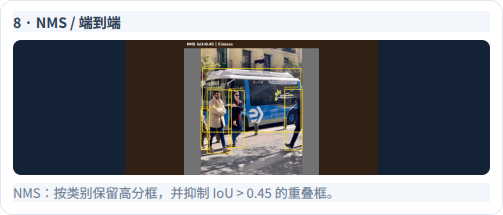 | 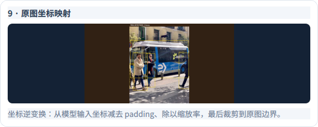 |
| 逐类去除高度重叠框。 | 撤销填充与缩放，将框映射回原图。 |

## ⑩ 状态机、检测与跟踪 / Detection and tracking

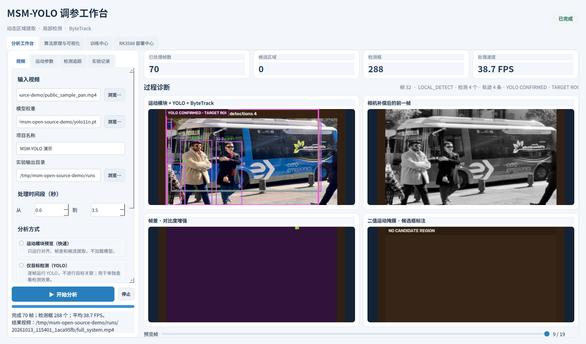

**我们的实现：**全图/局部检测状态机根据 YOLO 确认切换 ROI；统一的检测框接口接入 ByteTrack，页面同步显示轨迹、当前状态、候选区域和诊断帧。示例视频由公开静态图片平移生成，只用于展示流程；图中的 FPS 也仅对应这段桌面端演示。

**Our work:** ROI state transitions, detector/tracker adapters, synchronized state and diagnostic views. This panning clip is a UI demonstration, not a tracking benchmark.

## ⑪ 学习、训练与部署入口 / Learning and workflow pages

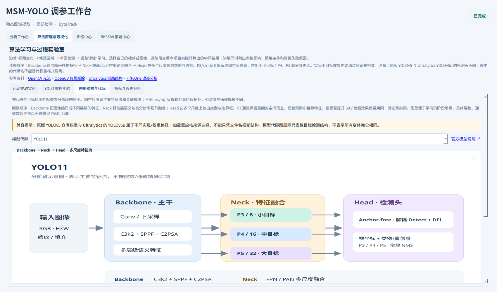

网络图是帮助阅读 Backbone、Neck 和 Head 的分阶段示意，按模型代际切换；它不是模型的完整逐层计算图，也不表示我们设计了新的 YOLO 结构。

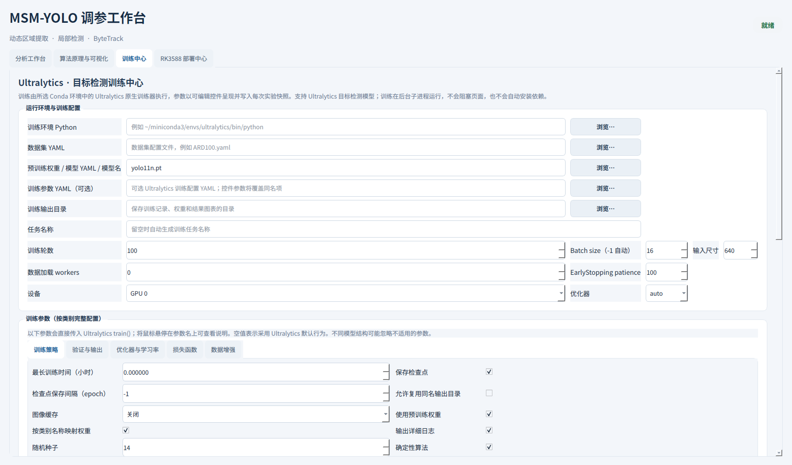

训练中心提供环境、数据 YAML、模型、轮数、设备及各类训练参数的可视化入口，并记录训练状态与产物。截图展示配置页面，未在截图时启动训练。

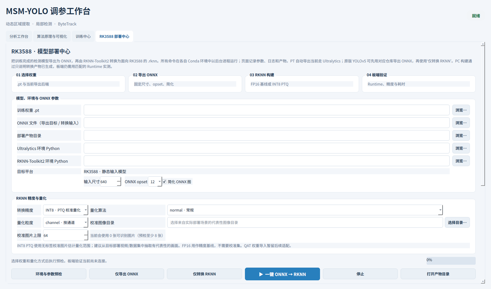

部署中心提供 PT → ONNX → RKNN 的桌面端配置入口、FP16/INT8 选择和校准图像参数。截图展示页面，未在截图时执行转换或板端验证。
